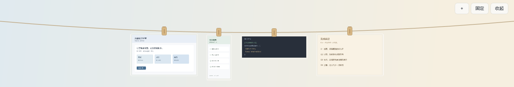
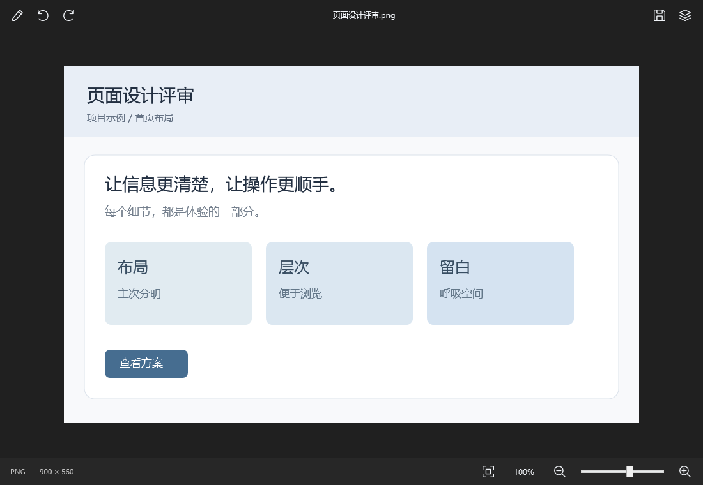
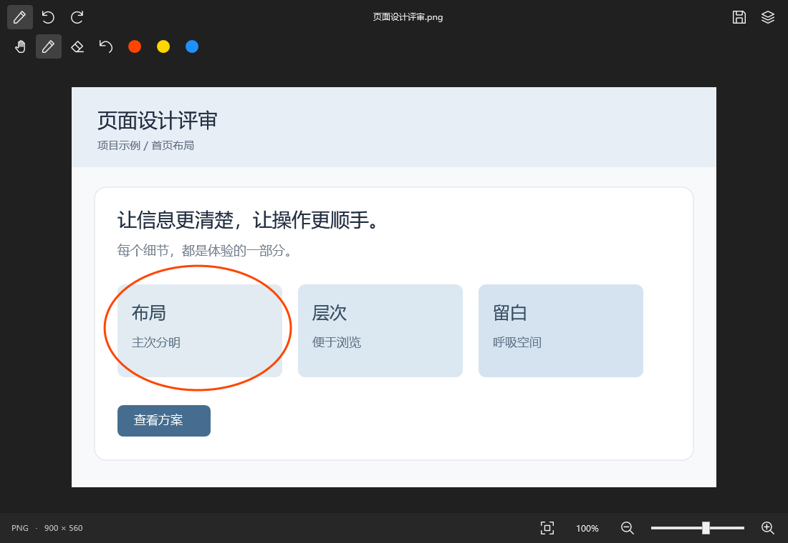

# 截图晾衣绳 · Snapline for Windows

Windows 10/11 x64 原生桌面截图收纳工具。使用 WPF / .NET Framework 4.8，无第三方依赖、不联网。交互参考 Tendedero，Windows 实现独立编写。

## 使用

双击 `Snapline.exe`，程序驻留右下角托盘。

- 用 `Win+Shift+S` 截图，图片进入剪贴板后自动收集。
- 鼠标移至屏幕顶部中间并停留约半秒，或按 `Ctrl+Alt+T` 展开晾衣绳；全屏应用中不自动展开。
- 快捷键或托盘手动展开会保持显示，按同一快捷键或点击收起可隐藏。顶部悬停展开有 2 秒缓冲，之后鼠标离开超过 1 秒才自动收起；固定时不自动收起。
- 单击图片复制，双击预览；拖到支持文件拖放的应用或文件夹，发送图片副本。
- 预览窗口支持左右旋转 90°、放大/缩小、适应窗口和原始大小；滚轮缩放，放大后拖动查看。底部提供适应图标、比例选择、缩小/放大图标和缩放滑杆；比例菜单可选择 100% 原始大小，窄窗口隐藏滑杆。Ctrl+0 适应窗口，Ctrl+1 原始大小，Ctrl++/− 缩放。
- 点击顶部画笔图标展开标注工具，悬停图标可查看名称；右键选择“标注”可直接进入。点击顶部保存图标会把旋转和标注保存到应用副本，缩放不改变保存分辨率；关闭不保存。
- 右键另存为或移除应用副本，导入的原文件保持不变。
- 遇到旧版留下的空白图片，可右键“修复空白图片”尝试恢复隐藏的颜色数据；若数据已经丢失，需要重新截图或导入原图。
- 普通滚轮左右浏览，触控板可横向滑动；鼠标靠近两侧时显示滚动箭头，左右方向键也可浏览。点击固定保持展开，Esc 或收起按钮隐藏。
- 绳子横贯当前显示器，背景透明。截图按自身宽高比悬挂，缩略图最大 180×120，不裁切、不加统一尺寸底板。图片连续横向滚动，两侧渐隐提示还有内容，夹子随固定绳子的弧线排列。新截图排在左侧，浏览旧图时保持当前图片的位置。没有常驻标题、说明和时间标签。复制等结果提示约 3 秒后消失。
- 托盘“窗口层级”或预览顶部的叠层图标可选择“始终置顶 / 普通层级 / 始终置底”，设置立即生效并记住，晾衣绳与预览共用；默认置顶，置底展开不抢前台。
- 顶部 ＋ 导入图片，固定/收起保留；说明在悬停提示或托盘“使用说明”中。标注工具栏会换行，Ctrl+Z 撤销上一笔。
- 托盘可导入图片、选择监听文件夹、分别关闭剪贴板/文件夹收集、打开收集文件夹或退出。

默认仅监听 Windows 截图文件夹中启动监听后新增的图片；不会批量导入已有图片。剪贴板收集也会接收你复制的其他图片，不读取文字或剪贴板历史。GIF/TIFF 只收集第一帧。

图片和配置保存在 `%LOCALAPPDATA%\Snapline`，图片副本为 PNG。最近 60 张显示在晾衣绳上，较旧副本仍在 inbox 文件夹中；不会自动清理。单图限制 80 MB、4000 万像素。

首次运行不读取当前剪贴板内容；只收集之后发生的变化。不设置开机启动、不更改系统截图配置。

## 界面预览

以下为软件实际界面导出，使用示例数据；桌面背景为示意，不含用户截图。







图文产品介绍位于 [docs/index.html](docs/index.html)，下载后可离线打开。本仓库未启用 GitHub Pages。

## 构建与验证

Windows PowerShell 中运行：

```powershell
.\build.ps1 -Test
```

使用系统 .NET Framework 编译器，无需额外安装 SDK；生成 `dist\Snapline.exe` 和配置文件。自检记录在 `artifacts\self-test.txt`，窗口渲染图在 `artifacts\shelf-preview.png`。自检使用独立临时图片，不接触用户剪贴板和截图目录。

`Snapline.exe --demo` 显示示例图片，使用临时收集目录，不监听真实剪贴板/目录。演示仍可手动复制图片。演示数据退出后删除。

## 验收边界

自检覆盖图片去重、持久化、源文件保护、文件夹稳定读取/失败重试、拖放数据、标注渲染、容量边界和 WPF 窗口渲染。实际 Win+Shift+S、托盘点击、顶部悬停、多显示器/DPI、拖入微信或其他应用，需要在对应真实环境中手动验收；各应用接收拖放的能力不同。
