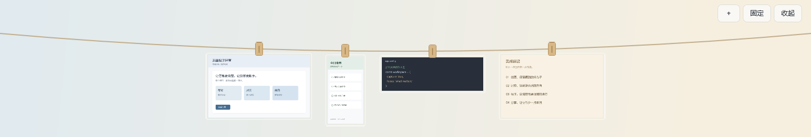
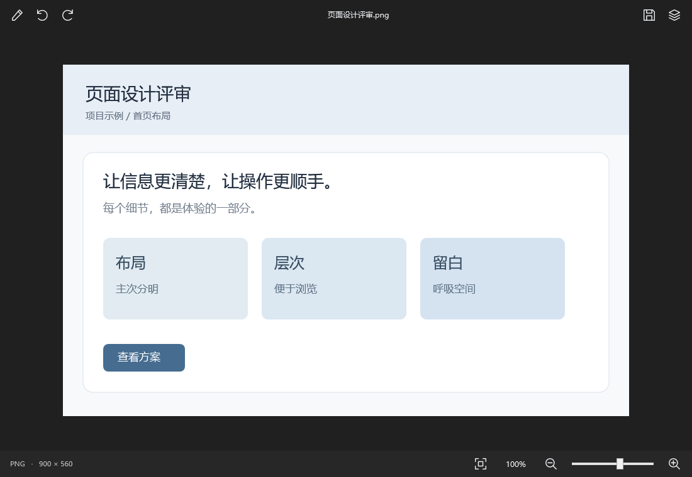
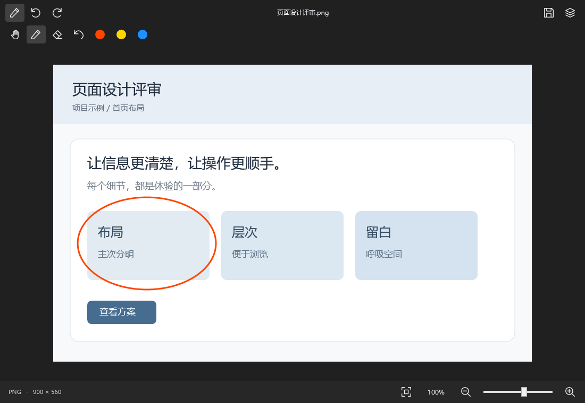

# 截图晾衣绳 · Snapline for Windows


**分辨率网络 出品 · 把截图留在手边。**

适用于 Windows 10/11 x64 的桌面截图收纳工具，支持截图、标注、取色与桌面贴图。使用 WPF / .NET Framework 4.8，无第三方依赖，日常使用可离线。Windows 实现独立编写。

## 特别致谢

感谢 [Tendedero](https://tendedero.app/) 带来的晾衣绳收纳灵感，感谢 [Snipaste](https://zh.snipaste.com/) 在截图、贴图与取色交互上的启发。向两款产品的创作者致敬，感谢你们的用心，让日常工作更轻松。

## 下载与安装

**[下载最新 Windows x64 安装包与免安装版](https://github.com/super-eggs/snapline-windows/releases/latest)** · [全部版本](https://github.com/super-eggs/snapline-windows/releases)

从发布页下载安装包后双击安装，再从开始菜单打开。安装到当前用户目录，无需管理员权限。可从 Windows 设置卸载，卸载会保留本地截图与配置。免安装版解压后即可运行。

从 1.0.2 起，安装包和免安装版文件名带有版本号。运行后右键系统托盘中的 Snapline 图标，菜单顶部会显示「当前运行版本」。

从 1.0.3 起，右键托盘图标可手动「检查更新」。检查时只向 GitHub 查询公开版本信息。安装版经确认后下载安装包并校验 SHA-256，完成截图保存后退出并打开安装向导，可覆盖原目录升级并保留截图和设置。需要保留的贴图请在升级前另存。免安装版会在浏览器中打开新版 ZIP 的下载地址，退出旧版后解压运行新版即可。

需要 .NET Framework 4.8 或更高版本。当前程序和安装包未进行代码签名，Windows 可能提示未知发布者或 SmartScreen 警告；请核对下载来源与 Release 中的 SHA-256 校验值。

## 使用

双击 `Snapline.exe`，程序驻留右下角托盘，首次展开晾衣绳时在后台加载历史缩略图。

- 按 `F1` 启动内置截图，也可从托盘点击“截图”。托盘“截图快捷键”可改为其他组合并记住；快捷键被占用时会提示，仍可使用托盘入口。`Win+Shift+S` 截图后自动收集的功能保留。
- 截图时悬停自动识别控件边界，单击确认；滚轮向上 / `1` 选择父级，向下 / `2` 返回鼠标所在的子级，最大到整窗。识别不到控件或查询尚未完成时仍可选择整窗；不提供无障碍信息的应用只能识别窗口。识别在后台进行，不读取控件文字；浏览器网页元素可能需要开启浏览器无障碍支持。拖动可自由框选，选区及八个控制点可调整大小；方向键移动 1 像素，Ctrl+方向键向对应边扩大 1 像素，Shift+方向键缩小 1 像素，Ctrl+A 全屏。W/A/S/D 逐像素移动光标。开始标注后锁定选区，撤销全部标注或“重新框选”后可重新调整。
- 框选和调整选区时默认不显示取色器，也不进行像素采样。确认选区后，点击工具栏滴管图标（取色器）再移动到选区内取色；点击或按 C 复制原图颜色，Shift 切换 HEX / RGB。再次点击滴管图标、按 Esc / 右键或切换标注工具可退出取色，截图保持打开。退出截图后按 F3 可把颜色贴成卡片。
- 截图工具栏使用紧凑图标，悬停可查看操作名和快捷键；正常宽度为单行，窄屏自动换行，全部功能保留。点击色点展开六色面板，点击线宽图标选择 2 / 3 / 5 / 8 px。内置截图与图片预览共用标注工具：画笔、矩形、椭圆、直线、箭头、中文多行文字、矩形马赛克；Shift 绘制正方形、圆或约束线条方向。文字点击输入，Ctrl+Enter 确认，Esc 放弃当前文字。确认后，用文字或手形工具拖动文字可调整位置，Ctrl+Z 可撤销移动。橡皮擦除整笔画笔，其他标注用撤销删除。
- 截图按 `Enter` / `Ctrl+C` 或“完成”会复制到剪贴板并保存到晾衣绳，即使关闭自动剪贴板收集也可保存；`Ctrl+S` 另存 PNG，另存后仍可继续标注。`Esc` 取消截图；右键先返回框选，再次右键退出。`Ctrl+Z` 撤销，`Ctrl+Y` / `Ctrl+Shift+Z` 重做，最多保留 100 步。
- F3 将当前剪贴板图片、颜色或文字贴到屏幕，Shift+F3 隐藏 / 显示全部贴图；两者均可在托盘改键并记住。若同时运行 Snipaste 等工具，需选择未占用的组合；改键失败保留原设置。相同剪贴板序号再次贴图会唤出现有窗口。截图时 Ctrl+T / “贴到屏幕”可直接贴出选区和标注；晾衣绳右键和预览顶部也提供贴图入口。
- 贴图始终置顶，无标题栏；拖动移动、滚轮缩放，Ctrl+滚轮调整透明度，0 恢复原始大小、Ctrl+0 适应屏幕，1 / 2 顺时针 / 逆时针旋转，3 / 4 水平 / 垂直翻转，方向键微移。空格展开共享标注工具，Esc 先收起工具、再关闭贴图；双击也可关闭。关闭后可用 F3 或托盘恢复上一张，Shift+Esc 销毁后不进入恢复记录。Ctrl+C 复制、Ctrl+S 另存 PNG，缩放和窗口透明度不改变输出像素；贴图中按 Alt 临时唤出放大镜，Shift 切换格式、C 复制颜色。
- 贴图保留在当前会话内，最多 32 张，同时保留上一张关闭的贴图；退出软件后不恢复，需要长期保留时请另存 PNG。文字转图只在主动贴图时读取当前剪贴板，限制 16000 字符；自动收集仍只读取图片。
- 右键托盘图标，可随时勾选或取消「顶部悬停展开晾衣绳」。此功能默认开启，鼠标在屏幕顶部中间停留约半秒即可展开，全屏应用中暂停触发。也可按 `Ctrl+Alt+T` 或双击托盘图标手动展开。
- 快捷键或托盘手动展开会保持显示，按同一快捷键或点击收起可隐藏。顶部悬停展开有 2 秒缓冲，之后鼠标离开超过 1 秒才自动收起；固定时不自动收起。
- 单击图片复制，双击预览；拖到支持文件拖放的应用或文件夹，发送图片副本。预览时按 `←` / `→` 按晾衣绳顺序切换上一张 / 下一张，到两端停住。有未保存的旋转或标注时，切换前会询问是否放弃修改。
- 预览窗口支持左右旋转 90°、放大/缩小、适应窗口和原始大小；滚轮缩放，放大后拖动查看。底部提供适应图标、比例选择、缩小/放大图标和缩放滑杆；比例菜单可选择 100% 原始大小，窄窗口隐藏滑杆。Ctrl+0 适应窗口，Ctrl+1 原始大小，Ctrl++/− 缩放。
- 点击顶部画笔图标展开标注工具，悬停图标可查看名称；右键选择“标注”可直接进入。点击顶部保存图标会把旋转和标注保存到应用副本，缩放不改变保存分辨率；关闭不保存。
- 预览时按 `Delete` 或点击顶部垃圾桶可删除当前图片的应用副本。删除后打开下一张，删到末尾时打开上一张，删完时关闭预览。也可在晾衣绳右键另存为或移除应用副本，导入的原文件保持不变。
- 遇到旧版留下的空白图片，可右键“修复空白图片”尝试恢复隐藏的颜色数据；若数据已经丢失，需要重新截图或导入原图。
- 普通滚轮左右浏览，触控板可横向滑动；鼠标靠近两侧时显示滚动箭头，左右方向键也可浏览。点击固定保持展开，Esc 或收起按钮隐藏。
- 绳子横贯当前显示器，背景透明。截图按自身宽高比悬挂，缩略图最大 180×120，不裁切、不加统一尺寸底板。图片连续横向滚动，两侧渐隐提示还有内容，夹子随固定绳子的弧线排列。新截图排在左侧，浏览旧图时保持当前图片的位置。没有常驻标题、说明和时间标签。复制等结果提示约 3 秒后消失。
- 托盘“窗口层级”或预览顶部的叠层图标可选择“始终置顶 / 普通层级 / 始终置底”，设置立即生效并记住，晾衣绳与预览共用；默认置顶，置底展开不抢前台。
- 顶部 ＋ 导入图片，固定/收起保留；说明在悬停提示或托盘“使用说明”中。标注工具栏会换行。
- 托盘可导入图片、选择监听文件夹、分别关闭剪贴板/文件夹收集、打开收集文件夹或退出。
- 托盘“开机自启（登录后）”可开启或关闭当前用户的 Windows 登录启动，默认关闭，无需管理员权限；启用后静默驻留托盘。开关直接保存为 Windows 启动项，重新打开菜单会读取实际登记状态；若在系统设置中禁用了启动项，需在 Windows 设置中重新允许。免安装版请先放到固定目录，移动后需关闭再开启此选项以更新路径；演示模式不可修改。

默认仅监听 Windows 截图文件夹中启动监听后新增的图片；不会批量导入已有图片。剪贴板收集也会接收你复制的其他图片，不读取文字或剪贴板历史。GIF/TIFF 只收集第一帧。

大图读取、编码和写盘在后台串行处理，历史加载不再重新编码图片，缩略图独立保存像素以减少内存占用。图片成功保存或确认重复后才完成文件夹收集；临时写盘失败会重试，持续失败的文件在提示后每分钟再尝试。通过托盘退出时会等待已接收的图片处理完成。

剪贴板图片连续写盘失败后会把已编码的快照暂存在内存，间隔 5 秒继续尝试；剪贴板内容随后变化也不会替换这张待保存图片。有待保存快照时，从托盘退出会提示可能丢失尚未保存的图片，默认取消退出。

图片和配置保存在 `%LOCALAPPDATA%\Snapline`，图片副本为 PNG。最近 60 张显示在晾衣绳上，较旧副本仍在 inbox 文件夹中；不会自动清理。单图限制 80 MB、4000 万像素。

首次运行不读取当前剪贴板内容；只收集之后发生的变化。仅在主动启用开机自启时登记当前用户启动项，不更改系统截图配置。

## 界面预览

以下为软件实际界面导出，使用示例数据；桌面背景为示意，不含用户截图。







产品宣传页位于 [docs/index.html](docs/index.html)，包含功能切换演示、快捷键、常见问题与下载入口；页面资源均在 `docs/` 中，可离线打开。页面区分当前开发版功能和已发布安装包。本仓库未启用 GitHub Pages。

## 构建与验证

Windows PowerShell 中运行：

```powershell
.\build.ps1 -Test
```

使用系统 .NET Framework 编译器，无需额外安装 SDK；生成 `dist\Snapline.exe` 和配置文件。自检记录在 `artifacts\self-test.txt`，窗口渲染图在 `artifacts\shelf-preview.png`。自检使用独立临时图片，不接触用户剪贴板和截图目录。

`Snapline.exe --demo` 显示示例图片，使用临时收集目录，不监听真实剪贴板/目录。演示仍可手动复制图片。演示数据退出后删除。

`Snapline.exe --capture-demo` 用合成桌面演示内置截图和标注，不读取真实桌面、不监听收集目录，完成时仅保存至临时目录，不改剪贴板；退出截图时结束演示。可用 `./build.ps1 -Test -OutputDirectory artifacts/capture-build` 在独立目录编译，避免覆盖正在运行的版本。

`Snapline.exe --pin-demo` 打开合成贴图供缩放、透明度、旋转、翻转、标注与取色验收，不读取或更改真实剪贴板；通过托盘退出演示。演示模式下，F3 / Shift+F3 被占用时临时使用 Ctrl+Alt+Shift+F10 / F9，仅作用于此演示；托盘显示实际组合。截图演示直接贴出选区后会保留演示进程，以便继续体验贴图。

## 打包与发布

安装 [Inno Setup](https://jrsoftware.org/isinfo.php) 后，执行 `./build.ps1 -Test` 和 `./package.ps1`，产物在 `artifacts/release/`：安装包、免安装 ZIP 和 SHA-256 校验文件。可用 `./package.ps1 -ISCC '编译器绝对路径'` 指定编译器。CI 固定使用允许商业用途的 [6.4.3 版本](https://github.com/jrsoftware/issrc/blob/is-6_4_3/license.txt)，下载时校验 SHA-256；如升级打包工具，需重新核对许可与兼容性。

`./installer/test-install.ps1` 在当前用户未安装 Snapline 时执行隔离安装、安装文件校验、快捷方式和注册检查、安装后窗口冒烟检查及卸载验证。它使用临时安装目录，不启动真实截图收集。

维护者发布新版本时，更新 `src/AssemblyInfo.cs` 两个版本号及 `src/app.manifest` 版本，更新 `.github/release-notes.md`，提交后推送对应的 `v主.次.补丁` 标签。GitHub Actions 自动构建、验证和发布。发布资产使用程序文件版本命名，例如 `Snapline-Setup-1.0.2-x64.exe` 和 `Snapline-Portable-1.0.2-x64.zip`。下载链接指向最新 Release 的资产列表。

推送与程序版本匹配的 `release-check/v主.次.补丁` 标签，可演练同一套构建、安装检查和上传流程。演练使用临时 GitHub Release 草稿，核对三个文件后删除草稿。演练完成后可删除演练标签。

正式发布完成后，GitHub Actions 从 GitHub Release 读取版本说明和已上传的下载文件，生成中英文官网的静态更新日志，由 Cloudflare Pages 发布。发布说明中的 `## 中文更新` 和 `## English updates` 分别用于中英文页面，在每个标题下用列表填写更新要点。需要重新同步已发布的版本时，可手动运行 GitHub Actions 的 `Sync website release notes`。

## 验收边界

自检覆盖图片去重、持久化、源文件保护、文件夹稳定读取/失败重试、拖放数据、标注渲染与撤销重做、马赛克、原始像素裁剪、遮罩下原生按钮/列表项及 WPF 控件的真实 MSAA 识别、父子层级切换与整窗回退、原生快捷键注册/冲突/释放、像素放大镜与取色、颜色/文字转贴图、贴图变换和会话恢复、容量边界和 WPF 窗口渲染。启动检查会对独立合成窗口的一小块区域执行真实桌面截图，验证颜色、透明度和尺寸，不保存其他桌面内容。实际 Win+Shift+S、托盘点击、顶部悬停、多显示器/混合 DPI、不同浏览器的控件支持、拖入微信或其他应用，需要在对应真实环境中手动验收；各应用接收拖放的能力不同。常用交互参考 [Snipaste 官方操作说明](https://github.com/Snipaste/feedback/wiki/基础操作)，当前尚不包含跨重启贴图恢复、贴图分组及鼠标穿透等完整能力。
